# Motor Track

An internal Android app for a small motorbike rental business. Each driver pays a daily rent by MTN MoMo. Motor Track reads the M-Money SMS on the phone that receives the money, marks each driver as paid, alerts the team when someone is late or short, and reports on collections and bank deposits.

**Version 0.6.1** · Android · Flutter app + free Supabase backend + Firebase push notifications

<p>
  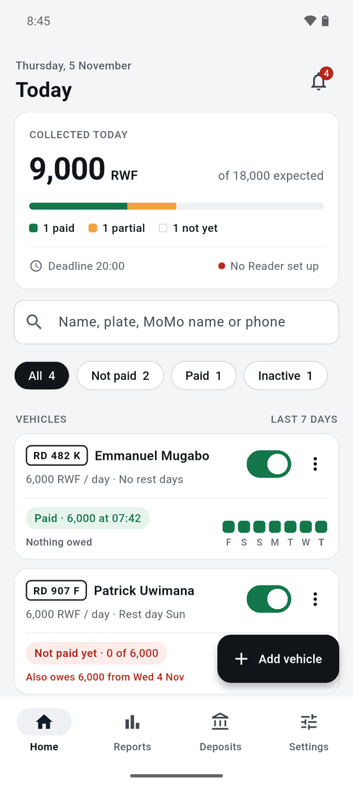
  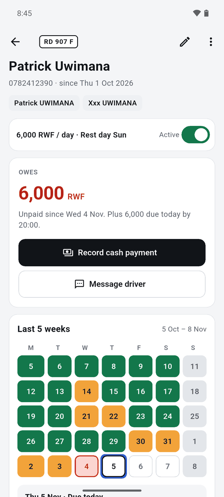
  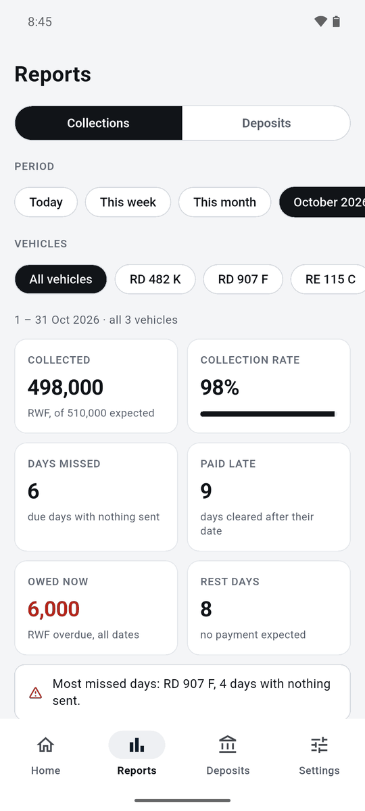
</p>

> All screenshots use the made-up sample data from `supabase/seed.sql` (drivers, phone numbers and team members are not real).

## Contents

- [What it does](#what-it-does)
- [Using the app](#using-the-app)
  - [1. Install it](#1-install-it)
  - [2. First start and joining the team](#2-first-start-and-joining-the-team)
  - [3. Home: today at a glance](#3-home-today-at-a-glance)
  - [4. A vehicle's page](#4-a-vehicles-page)
  - [5. Recording a cash payment](#5-recording-a-cash-payment)
  - [6. Adding, changing or stopping a vehicle](#6-adding-changing-or-stopping-a-vehicle)
  - [7. Alerts and messaging a driver](#7-alerts-and-messaging-a-driver)
  - [8. Reports](#8-reports)
  - [9. Deposits](#9-deposits)
  - [10. Settings](#10-settings)
  - [11. Setting up the MoMo phone (the Reader)](#11-setting-up-the-momo-phone-the-reader)
  - [Everyday tips](#everyday-tips)
- [How it works](#how-it-works)
- [Project layout](#project-layout)
- [Running it on your computer](#running-it-on-your-computer)
- [Tests](#tests)
- [Building the Android app](#building-the-android-app)
- [The live backend](#the-live-backend)

More detail on the business rules, decisions and data model is in [docs/PLAN.md](docs/PLAN.md). The clickable design of every screen: https://claude.ai/artifact/PEktzKYUAXMrMwohX21cHK

---

## What it does

- **Payments record themselves.** The phone that receives MoMo reads each "You have received…" M-Money SMS, matches the sender to a driver and records the payment. Other SMS never leave the phone.
- **Today at a glance.** How much came in today, who paid, who is short, who hasn't paid yet, and what each driver still owes from earlier days.
- **Cash too.** Record cash payments by hand, and note who is holding the money.
- **Oldest debt first.** A payment always clears the oldest unpaid day first, so nobody has to work out which day it was for.
- **Alerts on every phone.** At the deadline (default 20:00) if a bike hasn't paid in full, the next morning if a day was missed, when a payment arrives, when someone overpays, and if the MoMo phone stops reading SMS.
- **Message a driver** with a ready-made reminder in Kinyarwanda and English. It opens your own SMS app; nothing is sent automatically.
- **Reports** for today, this week, this month, any month or any date range: collected vs expected, collection rate, missed and late days, charts, a payment calendar and a per-vehicle table.
- **Deposits.** Record bank deposits and see how much money each team member is still holding.
- **Shared and live.** Everyone on the team sees the same numbers, updated live. Joining needs only a team code and your name.

---

## Using the app

### 1. Install it

The app isn't on the Play Store (Google doesn't allow apps that read SMS unless they are the phone's SMS app), so it is installed from an APK file.

1. Get the latest APK from whoever builds it. Use the **arm64** file for almost every phone. Only very old 32-bit phones need the **arm32** one.
2. Open the file on the phone. If Android asks, allow your file manager or chat app to **install unknown apps**.
3. To update later, install the new APK over the old one. Your data stays, because it lives in the shared database, not on the phone.

### 2. First start and joining the team

<p>
  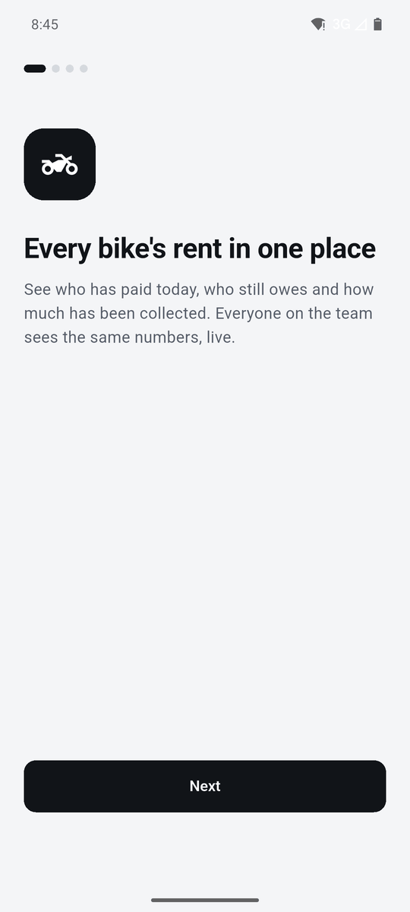
  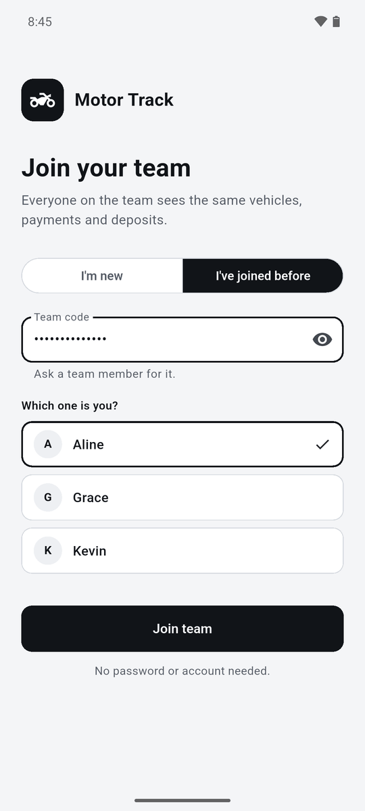
</p>

1. A few intro pages explain the app. Tap **Allow notifications** when asked, so alerts can reach you.
2. **Is this the MoMo phone?** Answer **Yes** only on the phone whose MoMo number drivers pay into. This takes you to [Reader setup](#11-setting-up-the-momo-phone-the-reader). Everyone else taps **No**.
3. **Join your team:**
   - First time: choose **I'm new**, type the **team code** and your name.
   - Reinstalled or on a new phone: choose **I've joined before**, type the team code, tap **Find my name** and pick yourself. Your past payments and deposits stay linked to you.

There is no password or account. The team code is the key, so share it only with the team.

### 3. Home: today at a glance


- **Collected today**: money received today against what is expected, with a bar showing how many bikes have paid, paid part, or not paid yet. Below it is today's deadline and whether the MoMo phone (the Reader) is working.
- **Bell** (top right): the [alerts](#7-alerts-and-messaging-a-driver). The red number is how many are new.
- **Search** by driver name, plate, MoMo name or phone number.
- **Filters**: All, Not paid, Paid, Inactive.
- **Vehicle cards**: the plate, the driver, the daily amount and rest days, and today's status:

  | Label | Meaning |
  |---|---|
  | Green **Paid · 6,000 at 07:42** | Paid in full today |
  | Orange **Partial · 3,000 of 6,000** | Some money came in, still short |
  | Grey **Not paid yet**, with "Due by 20:00" under it | Nothing yet, and the deadline hasn't come |
  | Red **Not paid yet**, with "Not paid by 20:00" under it | Nothing received and the deadline has passed (or older days are unpaid) |
  | **Rest day** | No payment expected today |
  | **Inactive** | The vehicle is switched off |

  A red line such as **Also owes 6,000 from Wed 4 Nov** shows older debt. If today's money all went to older days, the card says so. The row of squares is the **last 7 days** (green on time, orange late or partial, red missed, grey rest day).
- The **switch** turns a vehicle on or off. The **⋮** menu has Record cash payment, Message driver, Edit and Delete.
- **+ Add vehicle** at the bottom right.

<br clear="right">

### 4. A vehicle's page


Tap a card to open it. You see:

- The driver's phone, start date and **MoMo usernames** (the names the Reader looks for).
- **Owes** (or **Credit** if the driver paid ahead), and since when.
- **Record cash payment** and **Message driver** buttons.
- A **calendar of the last 5 weeks**. Each day is coloured: green paid on time, orange paid late, red outline missed, grey rest day, outlined today. Tap a day to see what was paid for it.
- The **payment list** further down, with MoMo or cash tags. Each payment's **⋮** menu can remove it if it was a mistake.
- The pencil (top right) edits the vehicle.

<br clear="right">

### 5. Recording a cash payment

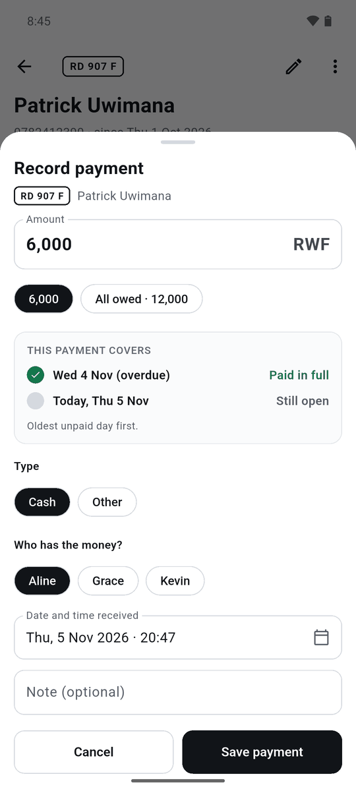

From a card's **⋮** menu or the vehicle page, tap **Record cash payment**.

1. Type the **amount**, or tap a shortcut such as **6,000** or **All owed**.
2. **This payment covers** shows which days the money will clear. It always pays the **oldest unpaid day first**.
3. Choose **Cash** or **Other**.
4. **Who has the money?** Pick the team member holding it. This feeds the [Deposits](#9-deposits) tab.
5. Check the date and time, add a note if you like, and tap **Save payment**.

The other phones get a notification about it. MoMo payments are recorded automatically by the Reader, so you only use this for cash or money that didn't come through the MoMo phone.

<br clear="right">

### 6. Adding, changing or stopping a vehicle

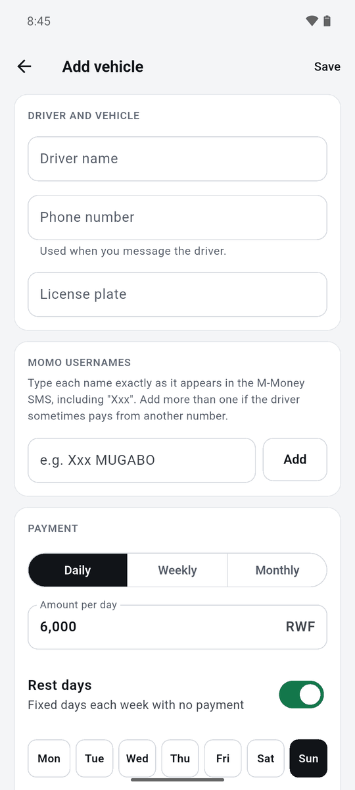

Tap **+ Add vehicle** on Home.

- **Driver name, phone number, license plate.** The phone number is used when you message the driver.
- **MoMo usernames.** Type each name **exactly as it appears in the M-Money SMS**, including `Xxx` if MTN hides part of it (for example `Xxx MUGABO`). Add more than one if the driver sometimes pays from another number. If a name is wrong, the Reader can't match that driver's payments.
- **Payment.** Daily, weekly or monthly, and the amount.
- **Rest days.** Fixed days each week with no payment (for example Sunday).
- **Start date.** Payments are expected from this day on.

To change a vehicle later, use **Edit** (in the **⋮** menu or the pencil on its page). A new amount applies from today; past days keep their old amount.

**Stopping a vehicle:** turn its **switch off**. No new days are expected, and its history stays in reports. Use **Delete** only for a vehicle added by mistake: it disappears from the list, the reports and the deposits, together with its payments.

<br clear="right">

### 7. Alerts and messaging a driver

<p>
  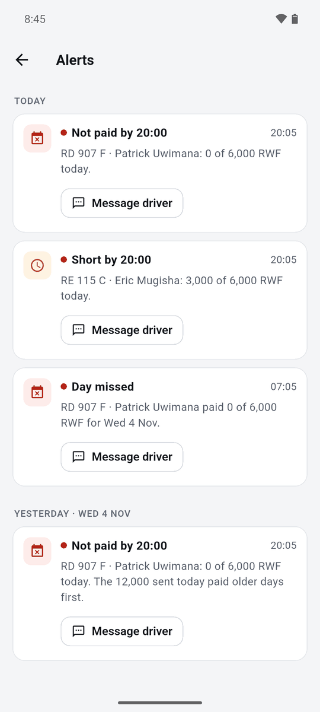
  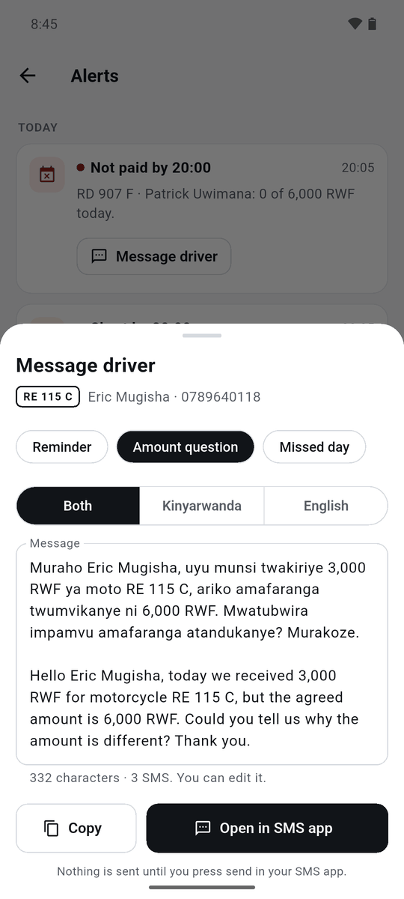
</p>

Alerts arrive as phone notifications on every team member's phone and are kept in the **Alerts** list (the bell on Home):

| Alert | When |
|---|---|
| **Not paid by 20:00** | At the deadline, if a bike has sent nothing for today |
| **Short by 20:00** | At the deadline, if a bike has sent part of today's amount |
| **Day missed** | The next morning (default 07:00), one summary of the bikes that didn't pay in full |
| **Payment received** | Each new payment, with what the driver still owes |
| **Overpayment** | When a driver sends more than they owe; the extra becomes credit for the next days |
| **Reader offline** | If the MoMo phone hasn't checked its SMS for 6 hours (daytime only) |

An alert clears itself once the day is paid. If you move the deadline in Settings to a time that hasn't come yet, today's alert waits for the new time.

**Message driver** (on an alert, a card's menu, or the vehicle page) opens a ready-made message:

1. Pick **Reminder**, **Amount question** or **Missed day**.
2. Pick **Both** languages, **Kinyarwanda** or **English**.
3. Edit the text if you want, then tap **Open in SMS app**. Your normal SMS app opens with the text filled in. **Nothing is sent until you press send there.**

### 8. Reports

<p>
  
  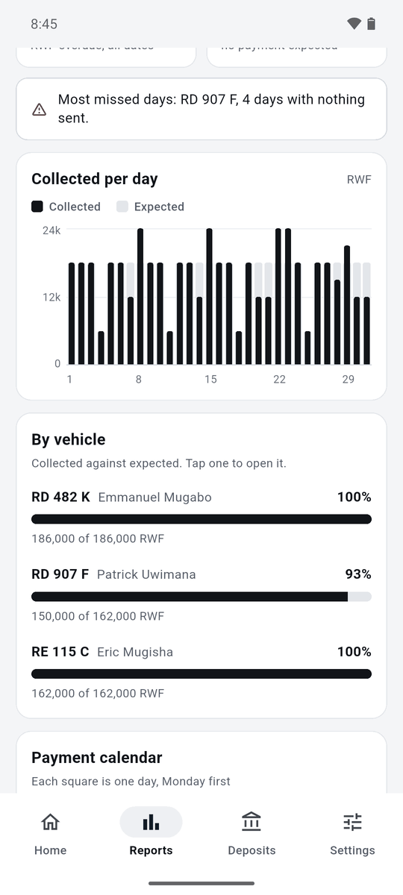
  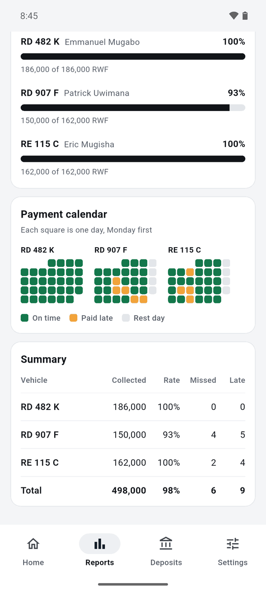
</p>

The **Reports** tab has two parts, **Collections** and **Deposits**.

- **Period:** Today, This week, This month, **Pick month** (any past month), or **Custom range** (any dates).
- **Vehicles:** all, or tap one or more plates to see only those. Switched-off vehicles stay in reports, marked "(off)"; deleted ones are left out.

**Collections** shows:

| Number | Meaning |
|---|---|
| **Collected** | Money received in the period, against what was expected |
| **Collection rate** | Collected ÷ expected |
| **Days missed** | Due days on which the driver sent nothing at all |
| **Paid late** | Days that were only cleared after their date |
| **Owed now** | Everything overdue right now, from any date |
| **Rest days** | Days with no payment expected |

Then a note about the bike with the most missed days, a **Collected per day** chart (per week or month for long periods), **By vehicle** bars (tap one to open the vehicle), a **Payment calendar** (one square per bike per day) and a **Summary** table.

Today's day only counts as missed or late once it is over, so a rate below 100% with 0 missed days usually just means today isn't paid yet.

<p>
  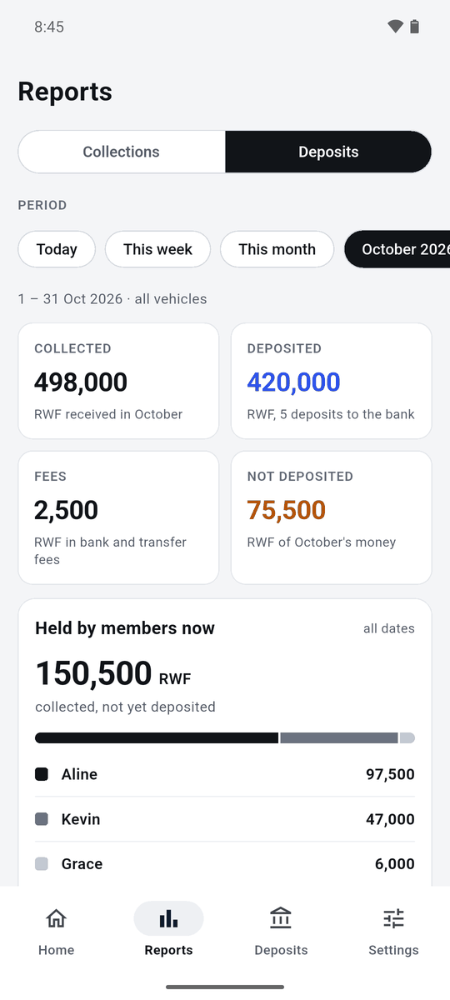
  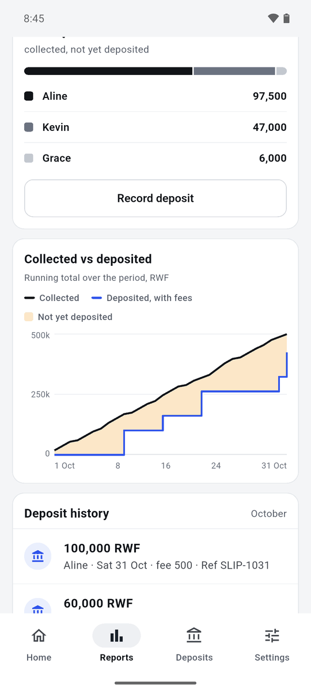
</p>

**Deposits** shows what was collected, deposited to the bank, paid in fees and not yet deposited for the period, how much **each member holds right now**, a running chart of collected vs deposited, and the deposit history.

### 9. Deposits

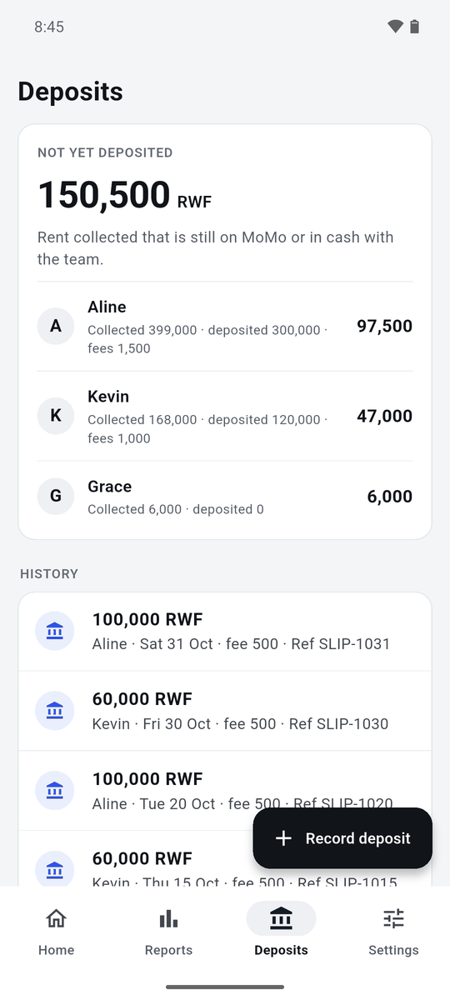

The **Deposits** tab shows how much rent is **not yet deposited**, split by team member: what each person collected, deposited and paid in fees.

To record a bank deposit, tap **+ Record deposit**, then:

1. Pick **whose money** it was (the member who held it).
2. Type the **amount deposited** (or tap **All … holds**), and any **fees**.
3. Set the **date**, and add the **bank reference** and a note if you like.
4. Tap **Save deposit**.

Tap a deposit in the history to see it in full or remove it if it was a mistake.

<br clear="right">

### 10. Settings

<p>
  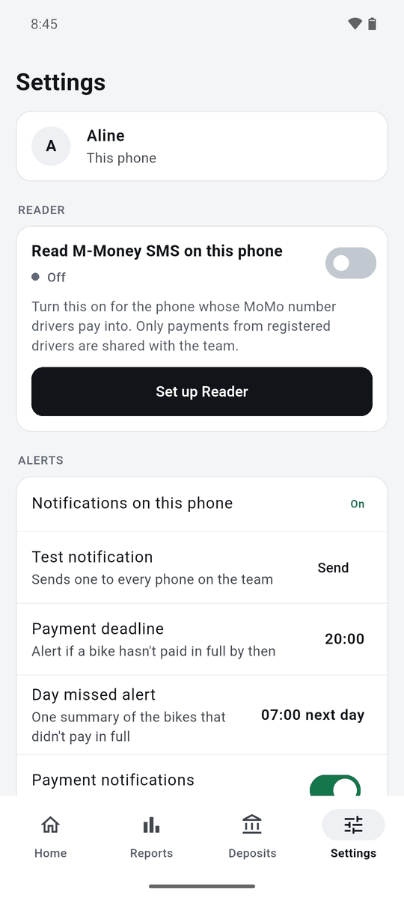
  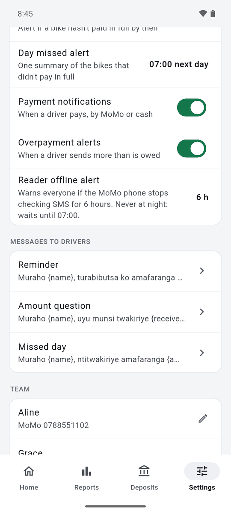
</p>

- **Reader:** turn the MoMo phone's SMS reading on or off, or set it up.
- **Alerts:**
  - **Notifications on this phone** and **Test notification** (sends one to every phone, to check they all receive alerts).
  - **Payment deadline** (default 20:00) and **Day missed alert** (default 07:00 next day). These are shared by the whole team.
  - **Payment notifications**, **Overpayment alerts** and **Reader offline alert** switches.
- **Messages to drivers:** edit the three message templates. Words in `{curly brackets}` such as `{name}` and `{amount}` are filled in automatically.
- **Team:** the members and their MoMo numbers.

### 11. Setting up the MoMo phone (the Reader)

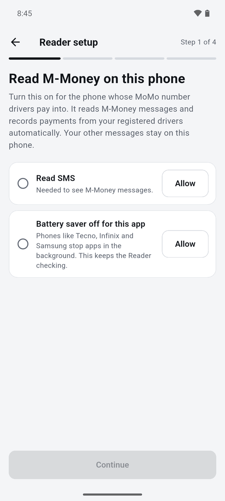

Do this once, on the phone whose MoMo number drivers pay into (Settings → **Set up Reader**):

1. **Permissions.** Allow **Read SMS**, and allow the app to ignore **battery saver**. Phones like Tecno, Infinix and Samsung otherwise stop the app in the background.
2. **Pick the sender:** tap `M-Money` in the list of SMS senders.
3. **Pick a sample:** tap a recent "You have received…" message. The app finds the amount, name, phone, date and transaction ID in it. If something is wrong, tap **Fix** and show it the right words.
4. **Almost done:** confirm the MoMo wallet is yours, choose whether to **import past payments** from registered drivers, and tap **Turn on Reader**.

From then on, the Reader checks for new M-Money SMS straight away and also every 15 minutes, and uploads only payments from registered drivers. If the phone is offline, payments wait and upload later. The same SMS is never counted twice.

Also set **Android Settings → Apps → Motor Track → Battery → Unrestricted** on this phone.

<br clear="right">

### Everyday tips

- Keep the MoMo phone **on, charged and online**. If it stops checking, everyone gets a "Reader offline" alert.
- If MTN changes the wording of its SMS, run **Set up Reader** again with a new sample.
- Record every **bank deposit**, so "not yet deposited" stays right.
- Open the app regularly: the free backend pauses after **7 days with no use** (it can be restored from the Supabase dashboard with no data lost).

---

## How it works

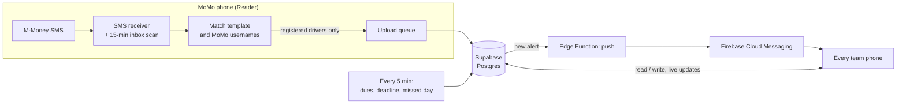

- **The database does the bookkeeping.** Daily dues, oldest-debt-first allocation, statuses and alerts all run inside Postgres, so every phone shows the same numbers and nothing depends on one phone being on.
- **A scheduled job runs every 5 minutes** (`private.tick()`): it creates the day's dues, runs the deadline and day-missed checks and watches the Reader.
- **Alerts become push notifications** through a small Edge Function that sends them with Firebase Cloud Messaging.
- **Security:** row-level security on every table. A phone can read or write only after joining with the team code (it gets an invisible anonymous sign-in). All times use Africa/Kigali.

---

## Project layout

```
motor-track/
├── app/                        Flutter app (Android now, iOS possible later)
│   ├── lib/
│   │   ├── main.dart           Start-up: connects to Supabase, picks intro / join / main screens
│   │   ├── config.dart         Backend URL and key, passed in at build time
│   │   ├── theme.dart          Colours and text styles from the design
│   │   ├── format.dart         Money, dates and Kigali time helpers
│   │   ├── prefs.dart          Small per-phone choices
│   │   ├── data/
│   │   │   ├── repo.dart       Everything the app reads from or writes to the database, with live updates
│   │   │   ├── models.dart     Vehicles, payments, members, deposits, alerts
│   │   │   ├── card_state.dart Today's status line on each vehicle card
│   │   │   ├── history.dart    Calendar days and their colours
│   │   │   ├── report.dart     Report periods and all report numbers
│   │   │   └── messages.dart   The three driver messages and their {fields}
│   │   ├── reader/             Dart side of the Reader: SMS template matching, setup, catch-up
│   │   ├── push/               Notification permission, token and tap handling
│   │   └── ui/                 One file per screen or sheet (home, vehicle detail, reports,
│   │                           deposits, settings, alerts, join, intro, Reader setup, …)
│   ├── test/                   Dart tests: card states, calendar, reports, messages, SMS template, catch-up
│   ├── android/app/src/main/kotlin/com/motortrack/motor_track/
│   │   ├── reader/             Native SMS receiver, 15-minute background scan, parser, upload queue
│   │   └── push/               Firebase messaging service and notification channels
│   ├── android/app/src/test/   Kotlin tests for the SMS parser
│   ├── env/example.json        Shape of the backend settings file (real ones are not in git)
│   └── pubspec.yaml            App version and packages
├── supabase/
│   ├── migrations/             The database, in order: tables, dues, allocation, alerts, push, security
│   ├── tests/database/         Business-rule tests (pgTAP): ledger, alerts, Reader, deadline changes
│   ├── functions/push/         Edge Function that sends notifications through Firebase
│   ├── seed.sql                Sample data for local development only
│   └── config.toml             Local Supabase settings
├── tools/make_icons.py         Draws the app icon for Android, iOS and web
├── docs/
│   ├── PLAN.md                 Business rules, decisions, data model, build order
│   └── screenshots/            The pictures in this README
└── dist/                       Built APKs to hand out (not in git)
```

---

## Running it on your computer

This runs the app against a **local** copy of the backend with sample data, so you can try things without touching the real data.

### What you need

- **Git**
- **Flutter 3.32** (stable, with Dart 3.8): https://docs.flutter.dev/get-started/install. Run `flutter doctor` and fix what it flags.
- **Android Studio**, for the Android SDK and an emulator (or an Android phone with USB debugging on)
- **Docker Desktop**, running (the local backend runs in Docker)
- **Node.js**, for `npx` (the Supabase CLI runs through it, nothing to install)

### Steps

1. **Get the code**

   ```bash
   git clone https://github.com/Yabsera-Haile/motor-track.git
   ```

   ```bash
   cd motor-track
   ```

2. **Start the local backend** (the first time downloads a few Docker images)

   ```bash
   npx supabase@3.0.0 start -x studio,imgproxy,storage-api,logflare,vector,mailpit,supavisor,postgres-meta,edge-runtime
   ```

   It prints an `API_URL` and a `PUBLISHABLE_KEY`. You need the key in step 4.

3. **Load the sample data**

   ```bash
   npx supabase@3.0.0 db reset
   ```

   This builds the database from `supabase/migrations/` and loads `supabase/seed.sql`: four bikes (one switched off) with payments from 1 Oct to 3 Nov 2026, deposits, and three members, Aline, Kevin and Grace. The local team code is `local-dev-code`.

4. **Tell the app where the backend is.** Copy `app/env/example.json` to the file for your device and fill in the local `PUBLISHABLE_KEY`:

   | File | Use it for | `SUPABASE_URL` |
   |---|---|---|
   | `app/env/emulator.json` | Android emulator | `http://10.0.2.2:54321` |
   | `app/env/local.json` | A phone on USB (after `adb reverse tcp:54321 tcp:54321`), or desktop/web | `http://127.0.0.1:54321` |

   These files are ignored by git.

5. **Run the app**

   ```bash
   cd app
   ```

   ```bash
   flutter run --dart-define-from-file=env/emulator.json
   ```

   (Use `env/local.json` for a USB phone.) In the app, go through the intro, choose **I've joined before**, enter `local-dev-code`, tap **Find my name** and pick **Aline**.

6. **When you're done**, stop the backend:

   ```bash
   npx supabase@3.0.0 stop
   ```

**Trying other times of day.** The database reads its clock from `app.now` when it is set, so you can test the 20:00 and next-morning checks in a database session, for example `set app.now = '2026-11-05 20:05+02'; select private.tick();`. The tests in `supabase/tests/database/` do this.

**Changing the database.** Add a new file in `supabase/migrations/` (never edit one that is already live), run `db reset` and the tests locally, then deploy it as described in [The live backend](#the-live-backend).

---

## Tests

Database rules (needs the local backend running):

```bash
npx supabase@3.0.0 test db
```

App logic:

```bash
cd app && flutter test
```

---

## Building the Android app

The app icon (Android, iOS, web) comes from `tools/make_icons.py`, which draws the Material Icons motorbike in white on the app's near-black. Run it from `app/` with the path to `materialicons-regular.otf` in the Flutter SDK (`bin/cache/artifacts/material_fonts/`) and a path for a preview image.

These files stay on the build PC and are not in git. Keep a backup of the first two: every update must be signed with the same key, or phones refuse to install it over the old version.

| File | What |
|---|---|
| `app/android/key.properties` | Signing key password |
| `app/android/app/upload-keystore.jks` | Signing key |
| `app/android/app/google-services.json` | Firebase config (download again from the Firebase console if lost) |
| `app/env/prod.json` | Supabase URL and publishable key of the live project |

```bash
cd app && flutter build apk --release --split-per-abi --dart-define-from-file=env/prod.json
```

Hand out `build/app/outputs/flutter-apk/app-arm64-v8a-release.apk` (most phones), or `app-armeabi-v7a-release.apk` for older 32-bit phones. Raise `version:` in `pubspec.yaml` for every release, and the version shown in Settings (`settings_screen.dart`).

Before handing an APK out, check it contains the app code: `lib/arm64-v8a/libapp.so` (about 6.5 MB) must be inside the file. An APK without it installs fine but closes as soon as it opens. That happened once after the build folder moved: Flutter's cache in `app/.dart_tool/flutter_build` still thought the code was compiled. Deleting that folder and building again fixes it.

`app/build` is a junction to `%LOCALAPPDATA%\MotorTrackBuild\app-build`, so OneDrive doesn't lock build files mid-build.

---

## The live backend

The real data lives in a Supabase project on the free plan. Firebase (free Spark plan) is used only to deliver push notifications.

### First-time setup

1. `npx supabase@3.0.0 login` (opens the browser)
2. `npx supabase@3.0.0 link --project-ref <project-ref>`
3. `npx supabase@3.0.0 db push`
4. In the Supabase SQL editor, set the team code: `select private.set_team_code('your team code');`
5. Push notifications (done for the live project on 4 Nov 2026). CLI 3.0 asks before changing the live project; `--yes` confirms.
   - `npx supabase@3.0.0 functions deploy push --use-api --no-verify-jwt`
   - Function secrets, from a temporary `.env` file you delete straight after (on Windows the shell mangles JSON passed on the command line):
     `PUSH_SECRET=<long random string>` and `FCM_SERVICE_ACCOUNT='<the Firebase service-account JSON on one line>'`, then
     `npx supabase@3.0.0 secrets set --env-file <that file>`
   - In the SQL editor, store the function URL and the same secret in Vault:
     `select vault.create_secret('https://<project-ref>.supabase.co/functions/v1/push', 'push_function_url');`
     `select vault.create_secret('<same long random string>', 'push_secret');`
   - Check with Settings → Test notification in the app. It reaches every phone that has opened 0.4.0 or later.

   To change the push secret, repeat the last two steps with a new value. The old one stops working.

### Deploying a database change

Check what will change, then apply it:

```bash
npx supabase@3.0.0 db push --dry-run
```

```bash
npx supabase@3.0.0 db push
```

### Keep out of git

This repository is public. Never commit secrets (the Firebase service-account JSON, signing keys, `google-services.json`, `env/*.json` other than `example.json`, the database password or the secret key) or real data (driver names, phone numbers, SMS, balances or transaction IDs). The publishable key is designed to ship inside the app; on its own it opens nothing without the team code.
