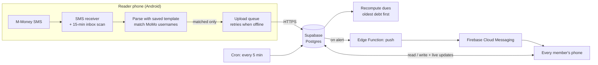

# Motor Track: MVP plan

An internal Android app for tracking rent payments from the company's motorbikes. It reads M-Money SMS to mark payments, alerts the team when a driver is late or short, and reports on collections and bank deposits.

Status (3 Nov 2026): building. Milestone 1 works against a local backend. The whole database engine (dues, oldest-debt-first, alerts, Reader matching) is built and tested. Waiting on the Supabase and Firebase projects (section 8).

---

## 1. Decisions made so far

| Topic | Decision |
|---|---|
| Late payment | **Oldest debt first.** A payment clears the oldest unpaid day, then the next. Reports still show a day paid after it was due as "late". |
| Partial payment | Payments in one period **add up** (3,000 + 3,000 = paid). Alert at the deadline (default 20:00) if the total is still short. Overpayment (money left over after all debt is cleared) alerts right away and becomes credit for future days. |
| Rest days | **Fixed weekdays only**, set per vehicle (e.g. every Sunday). Daily vehicles only. |
| "Day passed" alert | Default **07:00 next morning**. Changeable in Settings to 23:00, midnight, 07:00 or 08:00. |
| MoMo username | Entered **exactly as MTN shows it** (e.g. `Xxx MUGABO`). A vehicle can have **several usernames**. |
| Unknown senders | **Ignored and never uploaded.** The Reader phones are also personal phones, so other transactions stay private. |
| Manual payments | Allowed, tagged `cash` or `other`. They count the same as MoMo payments. |
| Undeposited money | Tracked **per member's wallet**: who holds how much, and who deposited what. |
| Contract type | Ongoing rental with no target or end date. |
| Joining | **Name + shared team code.** No password, no account. |
| Language | English screens. Messages to drivers are in **English and Kinyarwanda**. Built so Kinyarwanda screens can be added later. |
| Delete vehicle | *(My default, easy to change)* Deleting hides the vehicle but **keeps its payments in reports**. To pause a vehicle, use the Active switch. |

---

## 2. Tech stack

| Layer | Choice | Why |
|---|---|---|
| Mobile app | **Flutter** (Dart), Material 3 | One codebase for Android now and iOS later. Good charts (`fl_chart`) and good Supabase support. |
| SMS reading | Small **native Kotlin** SMS receiver inside the Flutter Android project, plus a background job (`workmanager`) that scans the inbox every 15 min | A plain Kotlin receiver is the most reliable option on Android. The inbox scan catches anything the receiver missed (phone off, battery saver killed the app). |
| Shared backend | **Supabase, Free plan** (Postgres database, auto-generated API, realtime updates, Edge Functions, Cron) | Free with no card. SQL makes the reports and the debt calculation straightforward. Scheduled jobs (the 20:00 check) run free. |
| Push notifications | **Firebase Cloud Messaging** (Firebase Spark plan, free), used for push only | The standard way to push to Android. Spark stays free and never needs a card as long as we don't use Cloud Functions. |
| Who-are-you | Supabase **anonymous sign-in** + team code | Each phone gets an invisible identity. The database only answers phones that entered the team code. |
| App distribution | Signed **APK** via Firebase App Distribution (free) or shared directly | The Play Store won't accept SMS-reading apps unless they're the default SMS app. Sideloading is normal for internal tools. |
| Source code | Git + a private GitHub repo (free) | Backup, history, and later free APK builds with GitHub Actions. |

**Why not Firebase for everything?** Firestore is free, but the 20:00 and next-morning checks need scheduled functions. On Firebase those require the Blaze plan, which needs a card on file. Supabase runs scheduled jobs on the free plan.

**Free-plan limits that matter.** Supabase Free gives 500 MB of database. Three bikes produce well under 1 MB a year, so that's room for hundreds of bikes. **A free project pauses after 7 days with no activity.** Daily use prevents that, and a paused project can be restored from the dashboard with no data lost.

### Platform limits
- **iPhones can't be Readers.** iOS doesn't let apps read SMS. An iPhone can do everything else. iOS push later needs an Apple Developer account ($99/yr).
- **No Play Store** while the app reads SMS (see above).

---

## 3. How it fits together

- **All business logic runs in the database** (dues, debt allocation, alerts), so every phone sees the same numbers and nothing depends on one phone being on.
- **Reader phones only send payments they matched.** Raw personal SMS never leave the phone.
- Every MoMo payment has a unique **FT Id**, so the same SMS read twice, or by two phones, is stored once.

---

## 4. Business rules

All dates and times use **Africa/Kigali** (UTC+2, no daylight saving).

### 4.1 Dues
A *due* is one amount a vehicle owes for one period.

| Frequency | Period | Due date | Rest days |
|---|---|---|---|
| Daily | One day | That day | Rest weekdays get no due |
| Weekly | 7 days | User picks the first due date, then every 7 days | n/a |
| Monthly | One month | User picks the first due date, then the same date each month (31st becomes the last day of shorter months) | n/a |

- Dues are only created while the vehicle is **active** and on or after its **start date**.
- **Deactivating** stops new dues. Today's due is removed if nothing has been paid toward it.
- **Changing the amount** applies from today's due onward. Past dues don't change.

### 4.2 Paying off dues (oldest debt first)
For each vehicle, payments are applied in time order to dues in date order:

1. Each payment fills the **oldest due that isn't fully paid**, then the next, until the payment is used up.
2. Money left over once every due so far is paid becomes **credit**. It pays future dues automatically when they're created.
3. This is recalculated from scratch whenever a payment is added, edited or deleted, or a due is created. With this little data, that takes milliseconds and keeps things correct.

**Status of a due** (shown on cards, the calendar and in reports):

| Status | Meaning | Colour |
|---|---|---|
| Paid on time | Fully paid by the end of the due date | Green |
| Paid late | Fully paid, but after the due date | Amber |
| Partial | Some money received, still short | Amber outline |
| Unpaid | Nothing received | Red |
| Due today | Today's due, not yet paid, deadline not passed | Grey |
| Rest day | No payment expected | Light grey |

**Report counts:**
- **Days missed** = due days on which the driver sent **nothing**. A rest day never counts.
- **Paid late** = dues that were fully paid only after their due date.
- **Owed now** = total overdue right now, across all dates.
- **Collection rate** = money received in the period ÷ money expected in the period.

**Side effect of oldest-debt-first:** if a driver stays behind, every following day shows as *paid late* until they catch up. Example: they send 3,000 short on Monday, then exactly 6,000 each day after. Each new payment first finishes the previous day, so the shortfall rolls forward. That's accurate, because they really are behind, and **Days missed** still counts only days with nothing sent.

**On the Home card**, today's status uses what was **sent today** (e.g. "Partial · 3,000 of 6,000"). Older debt is shown as its own line ("Also owes 6,000 from Mon 2 Nov").

### 4.3 Matching an SMS to a vehicle
1. The SMS **sender** must be the one chosen in Reader setup (e.g. `M-Money`).
2. The text must fit the saved **template** (see 5.2). Other M-Money messages, like transfers you sent, are ignored.
3. The **name** is compared with every vehicle's MoMo usernames. Case, extra spaces and the masked phone are ignored.
4. If two vehicles share a username, the last 3 digits of the masked phone (`*********123`) decide. If it's still unclear, the payment is skipped and the Reader phone shows a warning.
5. No match means the SMS is **ignored** and never uploaded.
6. The payment time is the time **in the SMS** (`at 2026-11-02 19:57:24`), not the time the phone read it.

### 4.4 Alerts (sent to every member's phone)

| Alert | When | Example |
|---|---|---|
| Not paid by the deadline | Deadline (default 20:00) on the due date, if the period total is short | "RAD 123 A, Jean: 0 / 6,000 RWF received today" |
| Short by the deadline | Same check, some money received | "RAD 123 A, Jean: 3,000 / 6,000 RWF received today" |
| Day missed | Settings time (default 07:00 next day): one summary | "Yesterday 2 bikes didn't pay in full: RAD 123 A (0), RAE 456 B (3,000)" |
| Overpayment | When a payment leaves credit | "RAD 123 A, Jean sent 12,000. 6,000 kept as credit" |

A day only alerts if its due already existed before that day's deadline. So a bike registered at 21:00, or added with a past start date, never alerts for those days. Alerts resolve on their own once the day is paid.

Every alert is also saved in the in-app **Alerts** list. Tapping one gives a **Message driver** button (see 4.6).

### 4.5 Deposits
- Each payment records **who holds the money**. For MoMo, that's the member whose phone read it. For cash, you pick.
- A deposit records: from whose wallet, amount deposited, fees (optional), date, bank reference/note.
- **Held by a member** = payments they received − (deposits + fees).
- **Not yet deposited (company)** = the total held by all members.

### 4.6 Messaging a driver
Never automatic. From an alert or a vehicle, **Message driver** opens a sheet with a suggested message in English and Kinyarwanda. You can edit it, then **Open in SMS app** opens your normal SMS app with the text filled in. You press send yourself.

Draft templates. **A native speaker needs to check the Kinyarwanda before release.** `{…}` fields are filled in automatically.

**Reminder** (nothing received):
> Hello {name}, a reminder that today's payment of {amount} RWF for motorcycle {plate} has not been received yet. Please send it today. Thank you.
>
> Muraho {name}, turabibutsa ko amafaranga y'uyu munsi angana na {amount} RWF ya moto {plate} ataratugeraho. Mwayohereza uyu munsi. Murakoze.

**Amount question** (short or different amount):
> Hello {name}, today we received {received} RWF for motorcycle {plate}, but the agreed amount is {expected} RWF. Could you tell us why the amount is different? Thank you.
>
> Muraho {name}, uyu munsi twakiriye {received} RWF ya moto {plate}, ariko amafaranga twumvikanye ni {expected} RWF. Mwatubwira impamvu amafaranga atandukanye? Murakoze.

**Missed day:**
> Hello {name}, we did not receive the payment of {amount} RWF for motorcycle {plate} for {date}. Please send it as soon as possible. Thank you.
>
> Muraho {name}, ntitwakiriye amafaranga {amount} RWF ya moto {plate} yo ku itariki {date}. Turabasaba kuyohereza vuba bishoboka. Murakoze.

The templates can be edited in Settings.

---

## 5. The Reader

### 5.1 Turning it on (Settings → Reader)
1. **Explain + permissions.** Asks for permission to read and receive SMS and to show notifications, then asks to exempt the app from battery optimisation. That last one matters on Tecno, Infinix, Itel and Samsung phones, which stop background apps.
2. **Pick the sender.** Lists the SMS senders on the phone with a message count and the latest preview. You tap `M-Money`.
3. **Pick a sample.** Shows recent messages from that sender. You tap a "You have received…" one.
4. **Confirm the fields.** The app highlights what it found, and you confirm each or tap *Fix* to select the right words:
   - Amount `6000` · Name `Xxx MUGABO` · Phone `*********123` · Date `2026-11-02 19:57:24` · Transaction `30012345678`
5. **Confirm the wallet.** "Money that arrives on this phone is held by: **{your name}** (MoMo 078…)". This links payments to the right person for deposits.
6. **Catch up.** "Found 14 payments from registered drivers in the last 30 days. Import them?" Repeats are skipped thanks to the FT Id.
7. **Done.** The Reader card in Settings shows "On · last checked 2 min ago".

### 5.2 Template
Steps 3–4 turn the sample into a saved pattern: `You have received {amount} RWF from {name} ({phone}) at {datetime} . Balance:{balance} RWF. FT Id: {txid}.` Templates are shared, so the second Reader can reuse the first one's. If MTN changes its wording, set up the template again. Nothing else changes.

### 5.3 Reliability
- **Two paths:** the instant receiver, and an inbox scan every 15 minutes and whenever the app opens.
- **Offline:** matched payments wait in a local queue and upload when the phone is back online.
- **Reader health:** every phone can see each Reader's "last checked" time. If a Reader hasn't checked in for 6 hours, the team gets a warning, so nobody assumes "no payment" when the real problem is "Reader phone is off".
- M-Money messages that look like "received" but don't fit the template are counted on the Reader phone ("2 messages couldn't be read"), so a wording change gets noticed.

---

## 6. Data model (Supabase / Postgres)

| Table | Key columns |
|---|---|
| `settings` (one row) | `team_code_hash`, `deadline_time` (20:00), `missed_alert_time` (07:00), `timezone` |
| `members` | `id`, `name`, `momo_number` |
| `devices` | `id` (anonymous auth uid), `member_id`, `fcm_token`, `platform`, `is_reader`, `template_id`, `last_checked_at` |
| `vehicles` | `id`, `driver_name`, `plate`, `phone`, `momo_usernames text[]`, `amount`, `frequency` (daily/weekly/monthly), `first_due_date`, `rest_weekdays int[]`, `start_date`, `is_active`, `deleted_at` |
| `dues` | `id`, `vehicle_id`, `period_start`, `period_end`, `due_date`, `amount_due`, `amount_paid`, `fully_paid_at` (unique per vehicle + period) |
| `payments` | `id`, `vehicle_id`, `amount`, `paid_at`, `source` (momo/cash/other), `sender_name`, `sender_phone_masked`, `tx_id` (unique), `held_by_member_id`, `recorded_by_member_id`, `note`, `deleted_at` |
| `allocations` | `payment_id`, `due_id`, `amount` (written by the recalculation) |
| `deposits` | `id`, `member_id`, `amount`, `fee`, `deposited_on`, `reference`, `note`, `recorded_by_member_id` |
| `alerts` | `id`, `type`, `vehicle_id`, `due_id`, `payment_id`, `body`, `created_at` (unique per type + due, so nothing alerts twice) |
| `sms_templates` | `id`, `sender`, `pattern`, `sample`, `created_by_member_id` |

**Database functions:** `join_team(code, name)`, `recompute_vehicle(id)`, `tick()` (every 5 min: create today's dues, run the deadline and missed-day checks, check Reader health), plus report queries for the date-range and vehicle filters.

**Security:** row-level security on every table, so only phones that joined with the team code can read or write. The app's public key is designed to be shipped inside apps. On its own it opens nothing.

---

## 7. Screens

| Screen | What's on it |
|---|---|
| **Join** (first launch) | Team code, your name (or "I'm returning" + pick your name) |
| **Home** | Today's total collected vs expected and how many bikes have paid · search (name, MoMo username, plate, phone) · filter chips (All / Not paid / Paid / Inactive) · vehicle cards · **+ Add vehicle** button bottom-right · bell icon for Alerts |
| **Vehicle card** | Plate + driver · status (Paid / 3,000 of 6,000 / Not paid yet / Rest day / Inactive) · amount + frequency · amount owed · last-7-days strip · Active switch · ⋯ menu (Edit, Record payment, Message driver, Delete) |
| **Vehicle detail** | Owed / credit · month calendar coloured by status · payment list (MoMo / cash tags) · actions |
| **Add / Edit vehicle** | Driver name · plate · phone · MoMo usernames (add several) · amount · Daily / Weekly / Monthly · first due date (weekly/monthly) · rest weekdays (daily) · start date · active |
| **Record payment** | Amount · date/time · cash / other · held by · note |
| **Alerts** | Grouped by day · each with **Message driver** |
| **Message driver** sheet | Template chips (Reminder / Amount question / Missed day) · editable bilingual text · **Open in SMS app** |
| **Reports: Collections** | Filters (Today / This week / This month / Pick month / Custom range; vehicles: all or some) · KPIs (Collected, Expected, Collection rate, Owed now, Days missed, Late) · collected-per-day chart vs expected · per-vehicle chart · payment calendar grid (bike × day) · per-vehicle table |
| **Reports: Deposits** | KPIs (Collected, Deposited, Fees, Not yet deposited) · held per member · collected vs deposited over time · deposit history |
| **Deposits** tab | **+ Record deposit**, recent deposits, what each member is holding |
| **Settings** | You · Reader · Alert times · Team (members, wallets, team code) · Message templates · About |

Clickable design of all of these screens: https://claude.ai/artifact/PEktzKYUAXMrMwohX21cHK (private until shared from its Share menu). Sample data: 3 bikes at 6,000 RWF/day for October 2026, and team members Aline, Kevin and Grace.

**Design system:** white cards on a light grey background, black for primary actions, Inter font with fixed-width digits. Status colours always come with a shape or label: green filled = on time, orange = late/partial, red outline = unpaid, grey = rest day. Blue is used only for "deposited" in charts.

---

## 8. Steps for you

Everything below is free and needs no card. **Don't upgrade Firebase to Blaze.**

### A. Supabase (database + backend)
1. Go to **supabase.com** → *Start your project* → sign in with GitHub (or email).
2. Create an organization on the **Free** plan → **New project**:
   - Name: `motor-track`
   - Database password: click *Generate*, then **save it in a password manager**. Don't paste it in chat.
   - Region: the closest one offered. Frankfurt (`eu-central-1`) is a good default for Rwanda.
3. **Authentication → Sign In / Providers →** turn on **Allow anonymous sign-ins** → Save.
4. **Project Settings → API keys:** copy the **Project URL** and the **publishable (anon) key** and send them to me. These two are meant to go into the app. **Never send the `service_role`/secret key or the database password.**
5. Later, when we set up the database, I'll ask you to run `supabase login` in the terminal. It opens your browser, so I never see a password.

### B. Firebase (push notifications only)
1. Go to **console.firebase.google.com** → *Create a project* → name `motor-track` → you can turn **Google Analytics off**. It stays on the free **Spark** plan.
2. **Add app → Android** → package name **`com.motortrack.app`** → *Register* → **download `google-services.json`** → skip the other steps. Keep the file. I'll tell you where it goes.
3. **Project settings → Cloud Messaging:** check that *Firebase Cloud Messaging API (V1)* shows **Enabled**.
4. **Project settings → Service accounts → Generate new private key** → it downloads a `.json` file. **This is a secret.** Don't send it in chat or commit it. Later you'll load it into Supabase with one command I'll give you.

### C. This computer
I can run these installs once you approve them, or you can do them yourself:
1. **Git:** git-scm.com
2. **Android Studio:** developer.android.com/studio (brings the Android SDK and Java)
3. **Flutter SDK (stable):** docs.flutter.dev/get-started/install/windows, then run `flutter doctor` and fix anything it flags
4. **Supabase CLI:** for running the database setup from here

### D. A test phone
1. On an Android phone: **Settings → About phone → tap *Build number* 7 times** → Developer options → turn on **USB debugging**.
2. Plug it in and accept the prompt. I'll install test builds on it.
3. For the real Reader test, a driver (or you, from a second SIM) sends a small MoMo amount from a registered username.

### E. Decide
- A **team code** (8+ characters). Share it only with the team.
- Who checks the **Kinyarwanda** templates.

---

## 9. Build order

| # | Milestone | Done when | Progress |
|---|---|---|---|
| 0 | Setup | Accounts ready, repo created, Flutter app runs on your phone, database tables created | **Partly done:** repo, app, database and tests run locally. Still to do: your Supabase/Firebase projects, install on a phone |
| 1 | Join + vehicles | Join with team code. Add / edit / delete / activate vehicles. Search works. Data shows on every phone. | **Done locally:** checked in the browser, including live updates |
| 2 | Dues + payments | Daily/weekly/monthly dues with rest days. Manual payments. Oldest-debt-first is correct (with tests). Today's total + card statuses. Vehicle detail. | **Engine and Home cards done.** Still to do: record-payment and vehicle-detail screens |
| 3 | Reader | Setup wizard, receiver + inbox scan, offline queue, catch-up import. Tested with real M-Money SMS. | Parser done and tested |
| 4 | Alerts | Push on all phones: deadline, missed day, overpayment, Reader health. Alerts list. Message-driver sheet. | Database side done (alerts, push function) |
| 5 | Deposits | Record deposits, see per-member holdings and history | Balances view done |
| 6 | Reports | Collections + Deposits reports with date and vehicle filters | |
| 7 | Release | Battery-saver testing on real phones, signed APK, installed on all 3 phones | |

**Tests:** the SMS parser (many sample messages, including `Xxx` names and odd spacing), the debt allocation (late, partial, overpaid, rest days, deactivated), and the report numbers.

---

## 10. Risks

| Risk | Mitigation |
|---|---|
| The phone's battery saver kills the Reader | Inbox scan every 15 min and on app open, battery-optimisation prompt, Reader-health warning |
| MTN changes its SMS wording | Template set up in the app, "couldn't read" counter |
| Supabase free project pauses after 7 idle days | Daily use keeps it awake; restore from the dashboard if it ever pauses |
| Someone extracts the key from the APK | Without the team code, the database refuses them (row-level security) |
| Two drivers with the same MoMo username | Last 3 phone digits decide; otherwise skip + warn |
| Kinyarwanda wording | Native speaker review; templates editable in Settings |
